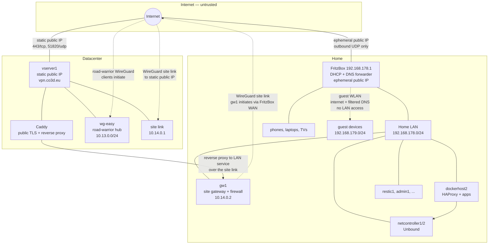
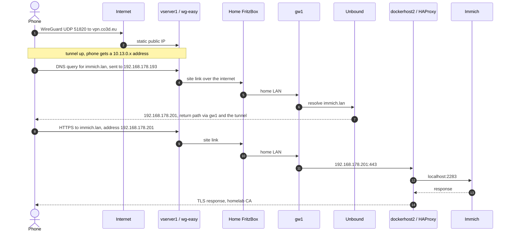
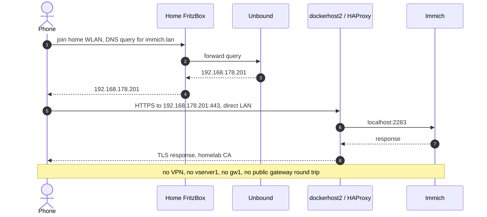
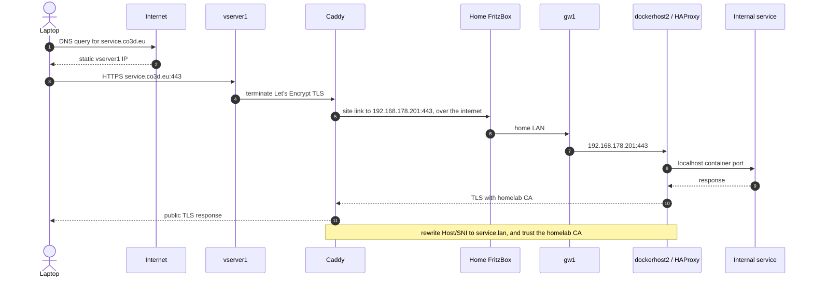
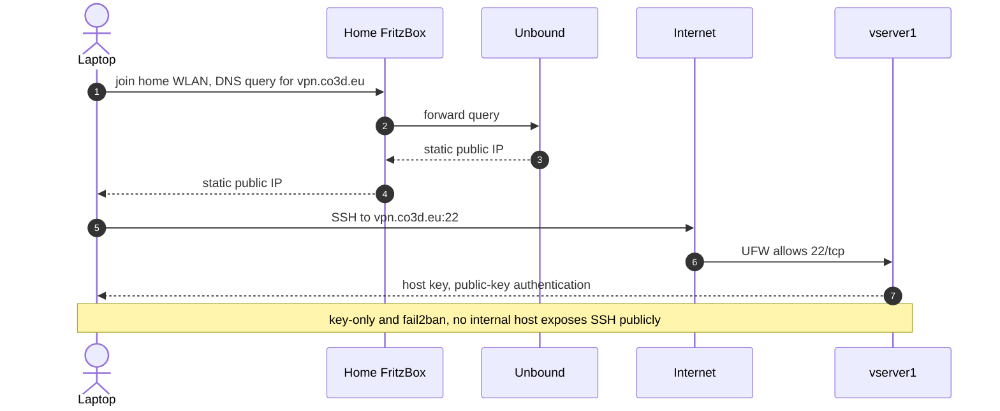

# Target Network Design

Status: **draft, design only**. This document assumes the proposed access model
**A — site-to-site gateway** from `access-models.md`. If that decision changes,
the DNS and TLS sections change with it:

- Model B keeps two names (`.lan` and `.vpn.lan`) and two SANs per service.
- Model C keeps one name but adds Unbound views and source-dependent answers.

## Target architecture



Solid lines are physical or routed reachability. Dashed lines are WireGuard
tunnels carried over the public internet; the `10.14.0.0/24` site link is a
logical overlay, not a dedicated circuit.

The physical path for the site link is:

```text
gw1 -> home LAN -> FritzBox -> ISP -> Internet -> vserver1
```

The FritzBox is the home router, not a LAN-only device. It owns the ephemeral
public IP, performs NAT, and carries the tunnel's outer UDP traffic. There is no
dedicated connection between home and the datacenter.

Because the home public IP is ephemeral and can change daily, **`gw1` is the
tunnel initiator** and `vserver1` is the stable rendezvous point. That has three
consequences:

- A home IP change causes a re-handshake, not a configuration change. No public
  DNS record or firewall rule needs to learn the new home address.
- No inbound port forwarding is required at home. Outbound UDP from `gw1` is
  enough, which also works behind CGNAT or DS-Lite.
- `gw1` should use a persistent keepalive so the NAT mapping stays open and a
  dead path is detected quickly.

Road-warrior clients follow the same rule: they initiate to the static
`vserver1` endpoint. Caddy's path to a home-hosted service goes over the same
site link, which is why the public edge needs a routed leg into the tunnel.

Key idea: the public edge has one routed leg into the private network. A service
endpoint can be a local container, a LAN address, or an overlay address; the
route table and firewall decide whether the gateway can reach it.

## Primary use-case paths

These are the four paths the design must keep working. They are sketches, not
packet-level traces. The notes call out the parts that are easy to get wrong.

### 1. Phone away from home, VPN on, opens Immich

The phone joins the VPN, resolves `immich.lan` through Unbound, and reaches the
LAN address over the site link. Caddy is not involved.



What this proves:

- The phone uses the same name and certificate as it does at home.
- DNS must be pushed as the Unbound LAN address, not a per-host overlay
  address.
- The return path from `gw1` to `vserver1` is the site link; the phone's own
  internet path is unrelated to the home WAN.
- No Caddy route exists for `immich.lan`; this is VPN/WLAN-only access.

### 2. Phone at home, VPN off, opens Immich

The phone uses the home WLAN, the FritzBox forwards DNS to Unbound, and the
phone connects directly to the LAN address. No VPN and no public edge.



What this proves:

- This is the primary home path and the reason the home LAN route exists.
- Ad blocking still applies because the FritzBox forwards to Unbound.
- `gw1`, `vserver1`, and the VPN can all be down without affecting this path.
- The same `immich.lan` name and certificate work here and in path 1.

### 3. Laptop away from home, no VPN, opens a public service that lives inside

Caddy terminates public TLS, then proxies over the site link to the internal
service. This is the location-independence path.



What this proves:

- The public edge reaches an internal service through one route, regardless of
  whether the service is a local container or a LAN host.
- The public leg uses Let's Encrypt; the internal leg uses the homelab CA. Caddy
  must trust the homelab CA, or the internal leg must be plain HTTP over the
  WireGuard tunnel.
- The internal service must accept the internal name in Host/SNI. Caddy rewrites
  the header, or the service gets a separate binding for the public name.
- A home internet outage takes this path down even though `vserver1` is healthy.

### 4. Laptop at home, VPN off, SSH to the public gateway

This is the only public SSH path. Internal hosts stay private.



What this proves:

- The public gateway is reachable for administration without the VPN.
- This path deliberately crosses the internet even though the laptop is at
  home; it does not use the site link.
- The only public SSH surface is `vserver1`. Internal hosts remain reachable
  only from the LAN or VPN.
- If public SSH is not wanted, restrict 22/tcp to the VPN and keep this path as
  a break-glass exception.

## Component responsibilities

| Component | Host | Responsibility |
| --- | --- | --- |
| Public reverse proxy | `vserver1` | Let's Encrypt TLS, public routes, auth, rate limits |
| VPN hub | `vserver1` | wg-easy road-warrior peers, `10.13.0.0/24` |
| Site link | `vserver1` ↔ `gw1` | Route the home LAN into the public edge, `10.14.0.0/24` |
| Home gateway | `gw1` | VPN ↔ LAN routing, allowlist firewall, static route target |
| Recursive DNS | `netcontroller1`/`netcontroller2` | Unbound, local records, blocklists, DNSSEC |
| DHCP + DNS forwarder | FritzBox | Addresses, default gateway, forwards DNS to Unbound |
| Internal TLS | per-host HAProxy + homelab CA | HTTPS inside the LAN and VPN |
| Internal services | `dockerhost2`, `restic1`, `admin1`, future hosts | Applications, bound behind HAProxy or localhost |

## Public edge

### Public names

| Public name | Upstream | Notes |
| --- | --- | --- |
| `co3d.eu` | website container or `gw1` → LAN service | Static site today |
| `status.co3d.eu` | status container or `gw1` → LAN service | Optional; see open decisions |
| `vpn.co3d.eu` | `wg-easy:80` | Admin UI; consider VPN-only or SSO |

Only names with an explicit Caddy route are public. Everything else is reached
through the VPN or the home WLAN.

### The missing data plane

Caddy currently runs on a Docker bridge network and wg-easy creates its
WireGuard interface inside its own container. The `vserver1` host therefore has
no route to `10.13.0.0/24` or `192.168.178.0/24`. Caddy can reach containers on
its own Docker network, but not VPN peers or LAN services.

The target design needs a deliberate data plane. Options, in order of
preference:

1. **Host-level site link + Caddy on the host network.** Run a dedicated
   WireGuard interface on `vserver1` for `gw1`, and run Caddy with host
   networking. Caddy binds 80/443 directly, the kernel routes to `gw1`, and
   there is no Docker NAT in the path. This is the easiest model to reason
   about.
2. **Host-level site link + Caddy on a bridge.** The host routes to `gw1`, and
   Docker NAT translates the container source to the host's site-link address.
   This works but adds a NAT layer and makes source-based firewall rules harder.
3. **A WireGuard sidecar for Caddy.** Put Caddy in the network namespace of a
   small WireGuard container. More moving parts, but keeps host networking out
   of Caddy.
4. **Make wg-easy a site peer with host networking.** Attractive on paper, but
   wg-easy is optimized for client peers; custom server-side `AllowedIPs` for a
   site link may not be exposed in the UI or the SQLite model. Verify before
   choosing this.

The site link is deliberately separate from the wg-easy road-warrior pool. It
keeps "user devices" and "site routing" independent, and it avoids relying on
wg-easy features it may not support.

### Public TLS

- Caddy obtains Let's Encrypt certificates with HTTP-01 or TLS-ALPN.
- Public names must resolve to `vserver1` before the first run.
- No wildcard is required. A wildcard would need DNS-01, which is harder with
  self-hosted authoritative DNS.
- Caddy renews automatically. See `context/guides/public-gateway-setup.md` for
  the current validation and troubleshooting flow.

### Public access control

- UFW: allow only SSH, 80/tcp, 443/tcp, optional 443/udp, and 51820/udp.
- Docker publishes only intended ports; a published container port bypasses
  UFW, so review the Compose files whenever a port is added.
- `vpn.co3d.eu` is an admin surface. Strong unique password, updated wg-easy
  image, and consider restricting it to VPN clients or putting an SSO proxy in
  front.
- Public services should not leak internal hostnames, IPs, or versions. A status
  page should show aggregate state, not a topology dump.
- Consider CrowdSec or equivalent for the public edge if the status page and
  website attract scanners. fail2ban already covers SSH.

### Public services hosted at home

The route model already supports an upstream such as
`192.168.178.201:443` or `10.13.0.11:443`. For that to work:

1. The site link must be up and the route to `192.168.178.0/24` must exist.
2. `gw1` must allow the public edge to reach that service IP and port.
3. The return path must reach `vserver1` (static route on the FritzBox or SNAT
   on `gw1`).
4. Caddy terminates public TLS; the internal leg may be HTTP over WireGuard or
   HTTPS with the homelab CA. HTTP over the tunnel is simpler and still
   encrypted.

If the home internet is down, a public service hosted at home is down even
though `vserver1` is up. That is an accepted consequence of hosting it at home.
Services that must survive a home outage belong on `vserver1`.

## VPN

### Road-warrior hub

- wg-easy on `vserver1`, UDP 51820.
- Client pool `10.13.0.0/24`.
- One peer per device. Revoke lost devices; do not share configs.
- wg-easy state lives in its SQLite database; back it up before upgrades.
- The UI is reachable at `vpn.co3d.eu` through Caddy, not on a separate public
  port.

### Client routing profiles

| Profile | `AllowedIPs` | Internet path | Internal access | Ad blocking |
| --- | --- | --- | --- | --- |
| Full tunnel | `0.0.0.0/0`, `::/0` | through `vserver1` | yes | yes, via pushed DNS |
| Split tunnel | `10.13.0.0/24`, `192.168.178.0/24` | direct | yes | DNS only, if DNS is pushed and routed |
| DNS-only | `10.13.0.0/24` plus the DNS address | direct | no, unless LAN is included | yes |

Under Model A, internal access needs the home LAN route. A DNS-only profile
therefore filters DNS but does not reach LAN service addresses. If that profile
is wanted, it needs a separate decision (for example, publishing overlay
addresses for a small set of services).

### DNS pushed to clients

Prefer the Unbound LAN addresses (`192.168.178.193`, `192.168.178.194`) over
the per-host overlay addresses. With the site link, they are reachable over the
VPN, and the same resolver answers identically on the WLAN and the VPN. This
also removes the need for wg-easy client-to-client forwarding for DNS.

If the site link is down, VPN access to the LAN is down anyway, so there is no
useful fallback.

### Client-to-client

Disable it unless a concrete service needs peer-to-peer traffic. Under Model A,
phone-to-Unbound and phone-to-service traffic is routed through `gw1`, not
between wg-easy peers.

### On-demand and the home WLAN

Expected mode: VPN off on the home WLAN. The phone uses the FritzBox resolver
and reaches LAN addresses directly.

Turning the VPN off at home costs nothing functionally:

- DNS filtering still applies, because the FritzBox forwards to Unbound.
- Internal names still resolve to LAN addresses.
- Traffic stays on the local network and does not touch `vserver1`.
- The home WLAN is the trusted network; the VPN's encryption and public exit
  are not needed there.

If the VPN stays on at home, the phone may route the LAN into the tunnel, which
sends traffic to `vserver1` and back through `gw1`. The name still works, but the
path is suboptimal. Whether it happens depends on the client:

| Client behavior | Result |
| --- | --- |
| Keeps the on-link WLAN route ahead of the VPN default route | direct path, no action needed |
| Sends all traffic, including the LAN, into the tunnel | hairpin through `vserver1` and `gw1` |
| Supports excluding local networks from the tunnel | direct path while the VPN stays on |
| Supports SSID-based on-demand rules | VPN can be disabled automatically at home |

Mitigations, in order:

1. Turn the VPN off on the home WLAN (manual or an SSID-based on-demand rule, if
   the client supports one).
2. Use a client option that excludes local networks from the tunnel.
3. Accept the hairpin on the rare occasions both are active.

Do not build a split-tunnel profile that excludes `192.168.178.0/24` just to
avoid the hairpin: it also makes LAN addresses unreachable while you are away
from home, which defeats the single-name model. If that trade-off is wanted, it
needs a second profile and a separate naming decision.

### IPv6

The current wg-easy configuration has IPv6 enabled, but there is no IPv6 plan
for the LAN, DNS, or firewall. Decide explicitly:

- disable IPv6 inside the tunnel for now, or
- dual-stack the site link, LAN, and Unbound records.

Running a half-configured dual stack is worse than either option. This is an
open decision.

## DNS and naming

### Resolver roles

Unbound on `netcontroller1` and `netcontroller2` is a recursive resolver with:

- local data for the internal zone,
- forwarding for `fritz.box` to the FritzBox,
- forwarding for the public namespace to public resolvers,
- RPZ-derived blocklists,
- active/passive rollout through `configure-netcontroller.yml`.

It is not an authoritative public DNS server.

### Zones and forwarders

| Zone | Handling |
| --- | --- |
| `lan.` | Local data from inventory |
| `fritz.box.` | Forward to `192.168.178.1` for router and device names |
| `.` | Forward to public resolvers such as `9.9.9.9` and `1.1.1.1` |
| `co3d.eu.` | Resolve normally, or forward to the authoritative server if it is internal |

**Loop warning.** Once the FritzBox uses Unbound as its upstream DNS, remove
`192.168.178.1` from Unbound's global `.` forwarders. Otherwise:

```text
client -> FritzBox -> Unbound -> FritzBox -> Unbound -> ...
```

Keep the `fritz.box` forward zone pointing at the FritzBox; that zone is
authoritative on the router and does not loop back to Unbound.

### Naming scheme

| Kind | Pattern | Example |
| --- | --- | --- |
| Internal service | `<service>.lan` | `immich.lan`, `paperless.lan`, `grafana.lan` |
| Internal host | `<host>.lan` | `dockerhost2.lan`, `restic1.lan` |
| Infrastructure | `<role><n>.lan` | `dns1.lan`, `dns2.lan` |
| Public service | `<service>.co3d.eu` or apex | `status.co3d.eu`, `co3d.eu` |
| Public VPN UI | `vpn.co3d.eu` | fixed |

Rules:

- Prefer fully qualified names in inventory and certificates.
- Do not use `.local`; it is reserved for mDNS and causes resolver ambiguity.
- Keep `.lan` for the first iteration. It is widely used but not formally
  reserved. `.internal` (ICANN-reserved for private use) or `home.arpa`
  (RFC 8375) are safer long-term choices; migrating later means reissuing
  certificates and updating bookmarks.
- Avoid publishing `.vpn.lan` names under Model A. Keep them during the
  transition if they are already in use.

### Record sources

DNS records come from three inventory-driven sources:

1. `homelab_dns_records` in `inventory/group_vars/all/dns.yml` — global IP to
   alias mapping.
2. `dns_aliases` in a host's `host.yml` — host-specific names.
3. `add_docker_reverse_proxy_bindings[*].hostnames[*]` — Docker reverse proxy
   names, collected automatically.

The `add_unbound` role merges them, validates them, and writes the Unbound
include. Under Model A, every internal alias should point at the host's LAN
address. `.vpn.lan` aliases require `add_vpn_client_overlay_ipv4` and should be
phased out.

Public names are not managed by Unbound. They live at the authoritative DNS
provider and must point at `vserver1`.

### Blocklists

- Sources: Hagezi RPZ multi and DoH lists, refreshed daily.
- The refresh script converts domains to `local-zone: "<domain>" always_nxdomain`.
- Blocking applies to every client whose queries reach Unbound, including
  clients behind the FritzBox forwarder.
- `always_nxdomain` can cause some apps to retry or hang. If that becomes a
  problem, evaluate `always_nodata` or a redirect to `0.0.0.0`.
- DoH/Private DNS bypasses the blocklist. Android Private DNS, iOS iCloud
  Private Relay, and browser DoH can all escape. The reliable mobile path is
  full-tunnel VPN with pushed DNS. Document this rather than trying to block
  every bypass.

### Access control

The current Unbound server config allows `0.0.0.0/0` and `::0/0`. That is too
open even behind the router. Restrict to:

- loopback,
- `192.168.178.0/24` (home LAN and FritzBox forwarder),
- `192.168.179.0/24` if guest clients should get blocking,
- `10.13.0.0/24` (road warriors),
- `10.14.0.0/24` (site link, for the public edge if it queries Unbound).

Deny everything else. Never forward port 53 from the internet to Unbound; an
open resolver is an abuse target. Add Unbound rate limiting per client.

### FritzBox integration

1. Set the FritzBox upstream DNS to `netcontroller1` and `netcontroller2` if the
   firmware allows two entries; otherwise use one and document the fallback.
2. Remove the FritzBox from Unbound's global forwarders (see the loop warning).
3. Keep `fritz.box` forwarded to the FritzBox.
4. Verify from a LAN client:
   - `dig @192.168.178.1 immich.lan`
   - `dig @192.168.178.193 immich.lan`
   - `dig @192.168.178.1 example.com`
5. Check that the FritzBox does not cache a stale negative answer after a new
   record is added.

### Search domain limitation

The FritzBox hands out its own DNS suffix. Typing `immich` without `.lan` will
probably not resolve. Until Kea replaces the FritzBox DHCP, users need the FQDN
or a bookmark. A future Kea deployment can hand out a `.lan` search domain and
fix this properly.

### Guest WLAN

Guest clients should get:

- internet access,
- filtered DNS through the FritzBox → Unbound path,
- no route to `192.168.178.0/24`.

They will receive LAN answers for internal names but cannot connect. That is
acceptable. Do not add a DNS view to hide names from guests; the firewall is the
control.

### Public DNS availability

`co3d.eu` authoritative DNS is self-hosted. Two cases:

- **Authoritative DNS on `vserver1`.** Acceptable for public availability. Back
  it up and monitor it.
- **Authoritative DNS only at home.** Not acceptable for public services. A home
  outage would break public name resolution even though `vserver1` is up. Move
  the public zone to a reliable provider or run it on `vserver1` with a
  secondary.

This is an open decision because the current provider was not specified.

## Internal TLS

### Certificate authority

- Homelab CA in `context/homelab-ca/`.
- CA certificate: 3650 days by default, passphrase-protected key.
- Server certificates: 825 days by default, no passphrase, so services can start
  unattended.
- The CA private key is the most sensitive file in the repository workflow.
  Keep it offline or in a protected location, and back it up separately.

### Where TLS terminates

Current model: HAProxy on each Docker host terminates TLS on 443, redirects
HTTP to HTTPS, and proxies to the service on localhost. The certificate is a PEM
bundle for that host.

Alternative: one central internal reverse proxy terminates TLS for all internal
names. This simplifies certificate and name management but creates a central
internal choke point. Keep per-host HAProxy until there is a reason to
consolidate; it matches the current role and keeps failure domains small.

### Certificate names

The certificate must cover every name a client uses:

- Model A: one SAN per service, e.g. `immich.lan`.
- Model B: both `immich.lan` and `immich.vpn.lan`.
- Model C: one SAN, but the DNS answer changes by client.

The HAProxy role uses a single certificate per host. If one host serves several
names, generate the certificate with all of them:

```powershell
pwsh context/homelab-ca/new-client-certificate.ps1 `
  -Name dockerhost2 `
  -DnsName immich.lan,paperless.lan
```

After changing SANs, redeploy the host so the new PEM bundle is installed, then
verify:

```bash
openssl x509 -in context/homelab-ca/client/dockerhost2.crt -noout -text |
  grep -A1 "Subject Alternative Name"
```

### Client trust

Install `context/homelab-ca/ca.crt` on each phone and laptop:

- **iOS/iPadOS:** install the profile, then enable full trust for the root
  certificate in certificate trust settings.
- **macOS:** add to the login or system keychain and mark it trusted.
- **Windows:** install into Trusted Root Certification Authorities.
- **Android:** install as a CA certificate. Browsers trust user CAs, but apps
  targeting modern Android versions may not. This is the main limitation of the
  homelab CA choice.
- **Linux:** add to the system trust store or the browser's store.

Test with a browser first. If a native app refuses the certificate, the options
are a public wildcard for an internal subdomain (revisit D1), a browser/PWA
workflow, or app-specific trust configuration. Do not silently fall back to
HTTP.

### Rotation

- Reissue server certificates before expiry. Track expiry in monitoring; a
  sudden TLS failure is a poor first warning.
- Rotating the CA requires re-trusting the new root on every device. Avoid
  rotating the CA for convenience.
- Keep the server key mode `0600` and never commit it. The existing
  `.gitignore` excludes private keys.

### Public TLS

- Let's Encrypt through Caddy at `vserver1`.
- HSTS on public names is reasonable once the certificate flow is stable.
- Internal HSTS is optional. Avoid a long `max-age` until certificate rotation
  is routine, because a bad internal certificate becomes hard to bypass.

### Application awareness

Services behind a TLS-terminating proxy need to know the external scheme.
Paperless already has a known CSRF issue in `context/TODO.md`; set its trusted
origins and allowed hosts for every name it serves. Expect similar configuration
for other apps.

## DHCP and LAN

- The FritzBox remains the DHCP server.
- Keep the current split: DHCP `.20`-`.191`, static homelab `.192`-`.254`.
- Add static reservations for `gw1`, `netcontroller1`, `netcontroller2`,
  `dockerhost2`, `restic1`, and `admin1` if they are not already effectively
  static.
- Add a FritzBox static route for `10.13.0.0/24` via `gw1` so LAN hosts can
  reply to VPN clients. If the firmware cannot do this, SNAT on `gw1` is the
  fallback; it hides client identity but preserves connectivity.
- Keep the guest WLAN isolated. Do not add a guest-to-LAN route.
- Treat IoT devices as untrusted. A separate SSID or VLAN is an open decision;
  the FritzBox may limit what is possible without a second access point.

## Firewall and access matrix

| Source | Destination | Ports | Policy |
| --- | --- | --- | --- |
| Internet | `vserver1` | 22/tcp | allow, key-only, fail2ban |
| Internet | `vserver1` | 80/tcp, 443/tcp, 443/udp | allow |
| Internet | `vserver1` | 51820/udp | allow |
| Internet | home LAN | any | deny; no port forwarding |
| VPN client | Unbound | 53/tcp, 53/udp | allow |
| VPN client | allowlisted service IPs | 443/tcp, explicit ports | allow |
| VPN client | `gw1` management | 22/tcp | allow only if needed |
| VPN client | FritzBox, other LAN hosts | any | deny by default |
| Home LAN | internal services | 443/tcp, 22/tcp | allow as today |
| Home LAN | Unbound | 53 | allow |
| Guest WLAN | internet | any | allow |
| Guest WLAN | home LAN | any | deny |
| Guest WLAN | Unbound | 53 | allow if blocking is wanted |
| `gw1` | `vserver1` | 51820/udp | allow outbound |
| `vserver1` | `gw1` | site-link ports | allow |
| `vserver1` | allowlisted LAN services | explicit ports | allow |
| IoT | internet | any | allow, with DNS filtering |
| IoT | home LAN | any | deny except explicit integrations |

Notes:

- Docker-published ports bypass UFW. Audit Compose files whenever a port is
  added.
- `gw1` is the enforcement point for VPN-to-LAN traffic. Without its allowlist,
  Model A exposes the whole LAN.
- SSH to internal hosts should be LAN/VPN only. The public edge is the only host
  with a public SSH port.

## Failure modes

| Failure | Impact | Mitigation |
| --- | --- | --- |
| `vserver1` down | Public services and VPN down; home WLAN direct access still works | Monitor; keep public services that must survive at home or accept the outage |
| `gw1` down | Remote access to the LAN down; home WLAN direct access still works | Monitor; keep the VM small and backed up; HA is a later option |
| One Unbound resolver down | FritzBox fails over to the other | Active/passive rollout; monitor both |
| Both Unbound resolvers down | Internal names fail; internet may still work via FritzBox fallback | Monitoring, canary queries, documented recovery |
| FritzBox down | No DHCP, WLAN, or internet | Provider/router recovery; out of scope |
| DNS loop misconfiguration | Resolution fails or is slow | Keep the FritzBox out of Unbound's global forwarders; test after changes |
| Certificate expiry | TLS errors on internal services | Expiry monitoring and a rotation runbook |
| wg-easy database loss | Clients need re-enrollment | Back up the SQLite database outside the repository |
| CA key loss | Cannot issue new internal certificates | Offline backup of the CA key and certificate |
| Public authoritative DNS down | Public names fail to resolve | Host it on `vserver1` or a reliable provider |
| Home internet down | VPN and home-hosted public services down; `vserver1` services stay up | Place availability-critical services on `vserver1` |

## Operations

### Adding a service

1. Decide the exposure: public, VPN/WLAN only, or host-local.
2. Choose the name: `<service>.lan` for internal, `<service>.co3d.eu` for public.
3. Assign a static address or a Docker binding.
4. Add the DNS record through inventory (`homelab_dns_records`, `dns_aliases`,
   or a Docker reverse proxy binding).
5. Issue or update the homelab CA certificate with the new SAN.
6. Add the HAProxy binding or the central proxy route.
7. Add a `gw1` allowlist rule if the service is reachable over the VPN.
8. Add a Caddy route if the service is public.
9. Add monitoring and backup coverage.
10. Verify from the LAN, the VPN, and the public internet if applicable.

### Changing DNS

- Edit inventory, run `pwsh run.ps1 configure-netcontroller.yml`.
- The rollout updates passive resolvers first, verifies records, then updates the
  active resolver.
- Verify through the FritzBox, not only directly against Unbound, because that
  is the path most clients use.

### Adding a host

- Provision with `add-vm.yml`, assign a static address, and add it to inventory.
- Add `dns_aliases` and, if it serves Docker applications, reverse proxy
  bindings.
- Issue a host certificate with the correct SANs.
- Add the `gw1` allowlist rule if VPN clients should reach it.
- No new WireGuard peer is needed under Model A.

### Backups

- Homelab CA key and certificate (offline, separate from the repository).
- wg-easy SQLite database.
- Unbound inventory and generated configuration.
- FritzBox configuration export.
- Caddy data volume, if it holds account or certificate state.

### Monitoring

- DNS canary: resolve a known internal name through the FritzBox and through
  each Unbound resolver.
- Certificate expiry for internal and public names.
- VPN peer count and handshake age.
- Public endpoint probes for the website, status page, and VPN UI.
- Disk and service health on `gw1` and `vserver1`.

## Open decisions

| ID | Question | Recommendation |
| --- | --- | --- |
| O1 | Accept Model A (site-to-site) or keep Model B? | Accept A; keep B temporarily for management |
| O2 | Where does `gw1` run? Dedicated VM, netcontroller, or FritzBox WireGuard? | Dedicated small VM |
| O3 | Public-edge data plane: host networking, bridge + NAT, or sidecar? | Host-level site link + Caddy on host network |
| O4 | Where is authoritative DNS for `co3d.eu` actually hosted? | Not at home only; `vserver1` or a reliable provider |
| O5 | Keep `.lan`, or migrate to `.internal`/`home.arpa`? | Keep `.lan` now; revisit before certificates proliferate |
| O6 | Per-host HAProxy or one central internal proxy? | Keep per-host HAProxy for now |
| O7 | Is the wg-easy UI public, VPN-only, or behind SSO? | VPN-only or SSO; public only with strong auth |
| O8 | What does the public status page show, and is it authenticated? | Aggregate state only; no internal topology |
| O9 | Segment IoT devices from the trusted LAN? | Yes, if the FritzBox or an additional AP allows it |
| O10 | IPv6: disable in the tunnel or dual-stack end to end? | Disable in the tunnel until there is a full plan |
| O11 | When does Kea replace FritzBox DHCP? | After naming and VPN are stable |
| O12 | Do mobile clients need a split-tunnel or DNS-only profile? | Start with full tunnel; add profiles only with a clear use case |

## Implementation phases

No phase starts before O1 is accepted.

1. **Documentation and decisions.** Finish this design, resolve O1-O4.
2. **DNS hardening.** Restrict Unbound access, remove the forwarder loop, verify
   FritzBox forwarding, add monitoring.
3. **Internal TLS cleanup.** Confirm SANs, install the CA on client devices,
   test native apps, add expiry monitoring.
4. **Site gateway.** Build `gw1`, establish the site link, add routes and the
   allowlist.
5. **Public-edge data plane.** Give Caddy a route into the private network and
   verify a public route to a home-hosted service.
6. **Public services.** Add the status page and any additional public routes
   with access control.
7. **Cleanup.** Retire `.vpn.lan` names and per-host peers once nothing depends
   on them.
8. **Optional DHCP migration.** Replace the FritzBox DHCP with Kea and add a
   `.lan` search domain.

## Validation plan

Run these after each phase, from the indicated vantage point:

| Check | Command or method | Expected |
| --- | --- | --- |
| Internal name via FritzBox | `dig @192.168.178.1 immich.lan` | LAN address |
| Internal name via Unbound | `dig @192.168.178.193 immich.lan` | LAN address |
| Internal name via VPN DNS | `dig` from a VPN client | LAN address |
| LAN HTTPS | `curl -I https://immich.lan` | 200/302, trusted certificate |
| VPN HTTPS | `curl -I https://immich.lan` from mobile | 200/302, trusted certificate |
| Certificate SANs | `openssl x509 -in context/homelab-ca/client/dockerhost2.crt -noout -text` | Expected names only |
| Unbound config | `unbound-checkconf` | no errors |
| Unbound listeners | `ss -lntup` on the resolver | 53 on expected interfaces only |
| VPN routes | `wg show`, `ip route` on `vserver1` and `gw1` | Site link and LAN route present |
| Public site | `curl -I https://co3d.eu` | 200/301, valid public certificate |
| Public status | `curl -I https://status.co3d.eu` | 200, valid public certificate |
| Public-to-home route | `curl -I https://<public-name>` for a home-hosted service | Reaches the service through `gw1` |
| Guest isolation | from guest WLAN, `curl` a LAN service | connection fails |
| Ad blocking | `dig @192.168.178.1 <known-blocked-domain>` | NXDOMAIN or blocked answer |
